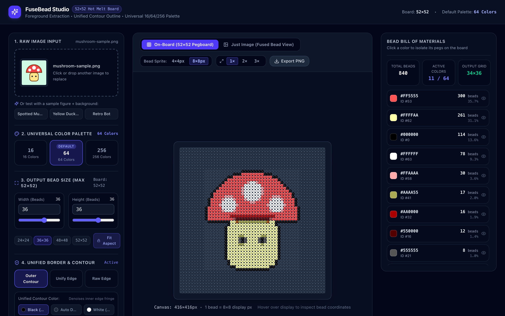
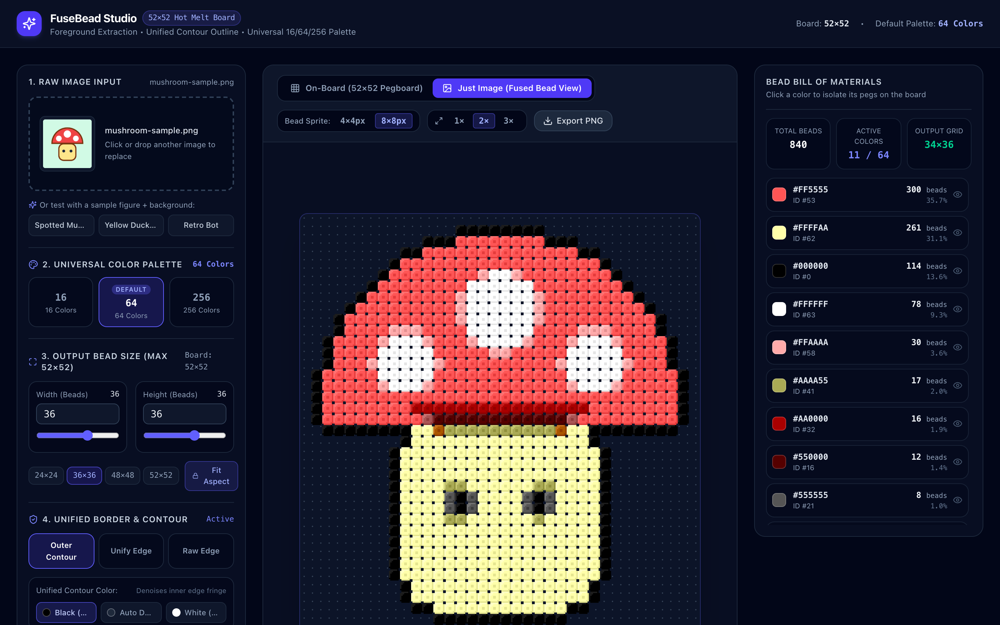
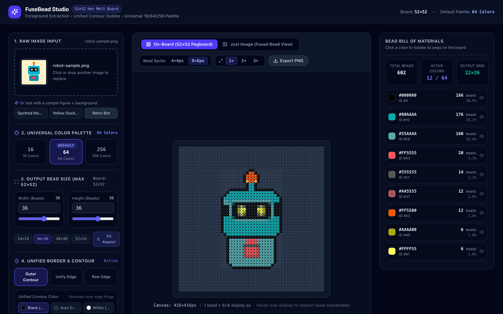

# FuseBead Studio (`fbplanner`)

[](./LICENSE)
[](./backend)
[](./frontend)

A full-stack web application that converts raw images and illustrations into craftable **52×52 Fuse Bead (Hot Melt Board)** templates.

Instead of naive image resizing (which creates blurry edges and muddy anti-aliased fringe colors), **FuseBead Studio** extracts the foreground subject, denoises boundary fringes, quantizes colors perceptually in **CIELAB (`L*a*b*`)** space onto **Universal 16 / 64 / 256 Color Palettes**, wraps a continuous **single-color contour**, and renders each bead as a **4×4 or 8×8 sub-pixel sprite** with rounded corners.

---

## Screenshots

### 1. "On-Board" Display Mode (52×52 Pegboard View)
Displays the full **52×52 pegboard** with raised center pegs on empty cells and unmelted hollow cylindrical fuse beads on occupied cells:



### 2. "Just Image" Display Mode (Post-Creation Fused Bead View)
Simulates the ironed/melted fuse bead piece after crafting, rendering each bead on an `8×8` (or `4×4`) pixel block with clipped rounded corners and a subtle center fused dimple:



### 3. Retro Bot Sample & Interactive Bead Bill of Materials (BOM)
Click any color in the right-hand **Bead Bill of Materials** to isolate and highlight its exact peg positions on the 52×52 board:



---

## Key Features

- **Automatic Foreground Extraction & Auto-Crop:** Strips background scenes (via local `rembg` ONNX session or deterministic OpenCV LAB + GrabCut segmentation) and crops tightly around the foreground figure so your subject maximizes the target bead dimensions.
- **Unified Border & Single-Color Contour:**
  - **Silhouette Smoothing:** Fills 1-bead pinholes and prunes stray 1-bead spurs.
  - **Boundary Fringe Denoising:** Replaces anti-aliased edge transition pixels with the nearest interior core color.
  - **Outer Contour / Unify Edge:** Wraps a continuous 1-bead outline (`Black #000`, `Auto Darkest`, or `White #FFF`) around the figure so the template looks crisp and holds together physically when ironed.
- **Universal `16 / 64 / 256` Color Palettes (Default: `64`):** Perceptual CIELAB ($\Delta E$) nearest-color matching onto standard 4-bit (16), 6-bit (64), and 8-bit (256) universal palettes.
- **52×52 Pegboard Constraint:** Target output dimensions (`W × H`, up to `52×52`) with optional aspect-ratio lock (`Fit Aspect`), automatically centered on the 52×52 board.
- **Sub-Pixel Bead Sprite Renderer (`4×4px` or `8×8px` per Bead):**
  - Instant local toggle between **On-Board (52×52 Pegboard)** and **Just Image (Fused Bead View)**.
  - Native `1×` hardware pixel rendering (`image-rendering: pixelated`) plus `2×` and `3×` crisp integer magnification.
  - Hover coordinate inspector (`Peg (col, row)` + color hex) and one-click **Export PNG**.

---

## Architecture & Project Structure

The repository is structured with strict **Frontend / Backend separation**:

```text
fbplanner/
├── backend/                        # Python + FastAPI Image Processing Service
│   ├── pyproject.toml
│   ├── requirements.txt
│   ├── app/
│   │   ├── main.py                 # FastAPI app factory & CORS setup
│   │   ├── config.py               # Board constants (52x52) & palette settings
│   │   ├── api/
│   │   │   ├── router.py           # /api/v1 router
│   │   │   └── endpoints/
│   │   │       └── templates.py    # GET /config, POST /templates/generate
│   │   ├── schemas/
│   │   │   └── template.py         # Pydantic request/response models
│   │   ├── services/
│   │   │   └── template_service.py # Multi-stage pipeline orchestrator
│   │   └── core/
│   │       ├── segmentation.py     # Foreground extraction & alpha auto-crop
│   │       ├── downsampler.py      # Alpha-premultiplied bilateral downsampler
│   │       ├── palettes.py         # Universal 16 / 64 / 256 palettes + CIELAB cache
│   │       ├── quantizer.py        # Perceptual CIELAB color matching & BOM counter
│   │       └── contour.py          # Silhouette smoothing, fringe denoising & unified outline
│   └── tests/
│       └── test_api.py             # Pytest suite for palettes, contour modes & API
│
└── frontend/                       # React + TypeScript + Vite + Tailwind CSS Studio
    ├── package.json
    ├── vite.config.ts              # Proxies /api -> http://127.0.0.1:8000
    └── src/
        ├── App.tsx                 # 3-column studio layout
        ├── api/
        │   └── templateApi.ts      # Typed HTTP client
        ├── types/
        │   └── template.ts         # Shared TypeScript interfaces
        ├── features/
        │   ├── controls/           # ImageUploader, PaletteSelector, DimensionControls, ContourControls
        │   ├── viewer/             # TemplateViewer, BeadCanvas & 4x4/8x8 ImageData sprite renderers
        │   └── legend/             # ColorBomPanel (inventory counts & single-color peg highlighter)
        └── utils/
            └── sampleSpriteGenerator.ts
```

---

## Getting Started (Local Development)

### Prerequisites
- **Python 3.11+** (with `pip` or [`uv`](https://docs.astral.sh/uv/))
- **Node.js 18+** and `npm`

### 1. Start the Backend Server (FastAPI — Port `8000`)

```bash
cd backend

# Create and activate a virtual environment (using uv or standard venv)
python3 -m venv .venv
source .venv/bin/activate

# Install dependencies
pip install -r requirements.txt

# Start the FastAPI server with hot-reload
uvicorn app.main:app --reload --host 127.0.0.1 --port 8000
```

*Interactive Swagger API docs will be available at `http://127.0.0.1:8000/docs`.*

### 2. Start the Frontend Dev Server (Vite — Port `5173`)

Open a second terminal:

```bash
cd frontend

# Install npm packages
npm install

# Start Vite dev server
npm run dev
```

Open **http://localhost:5173** in your browser. Vite automatically proxies `/api/*` requests to `http://127.0.0.1:8000`.

### 3. Run Tests & Production Build

```bash
# Run backend unit & integration tests
cd backend && .venv/bin/pytest -v

# Type-check and build frontend production bundle
cd frontend && npm run build
```

---

## License

Distributed under the **MIT License**. See [`LICENSE`](./LICENSE) for full details.
